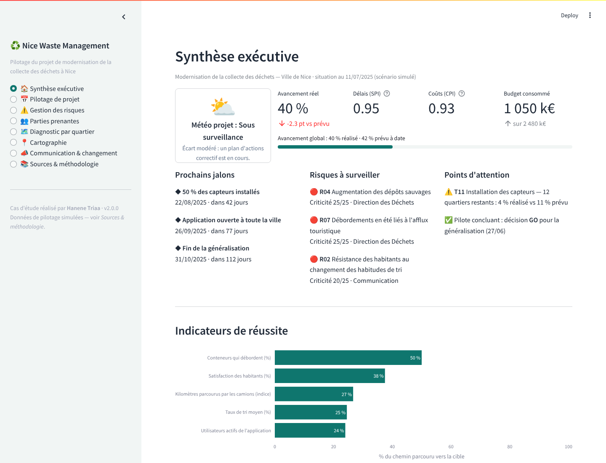
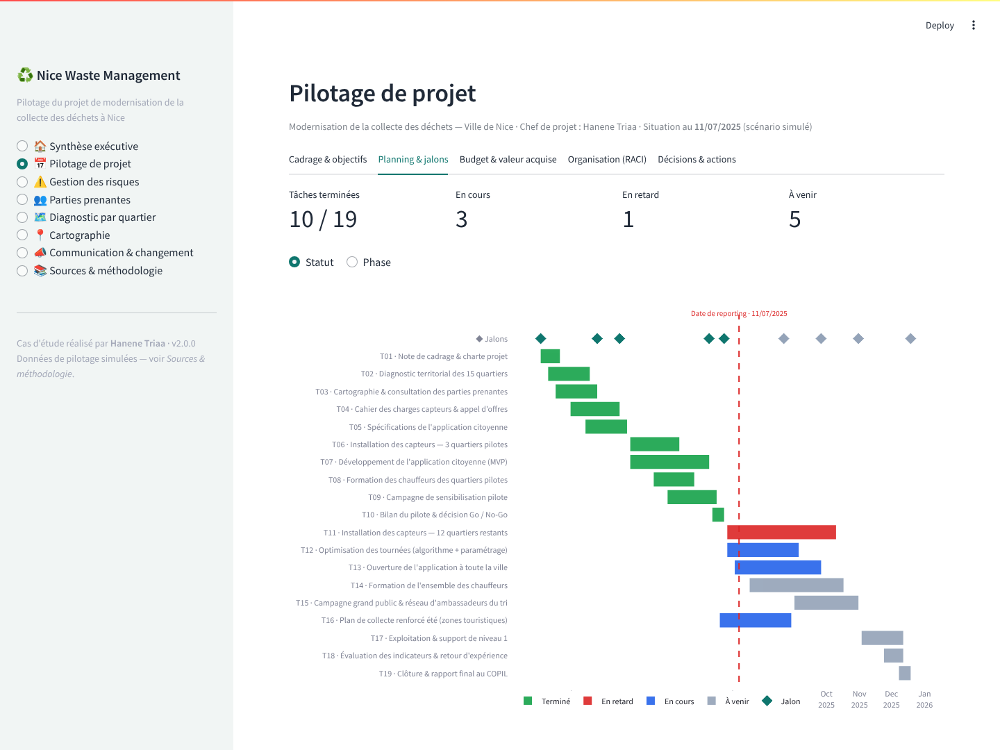
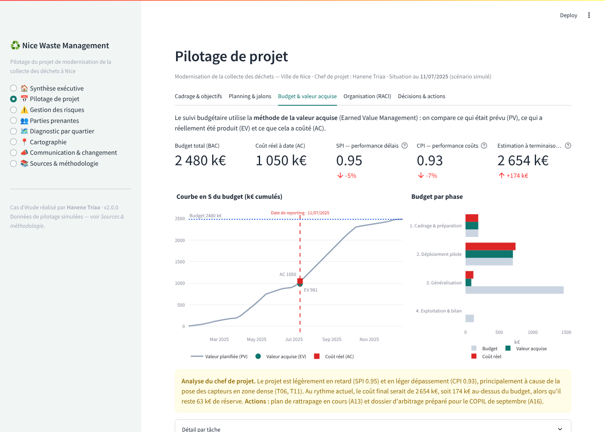
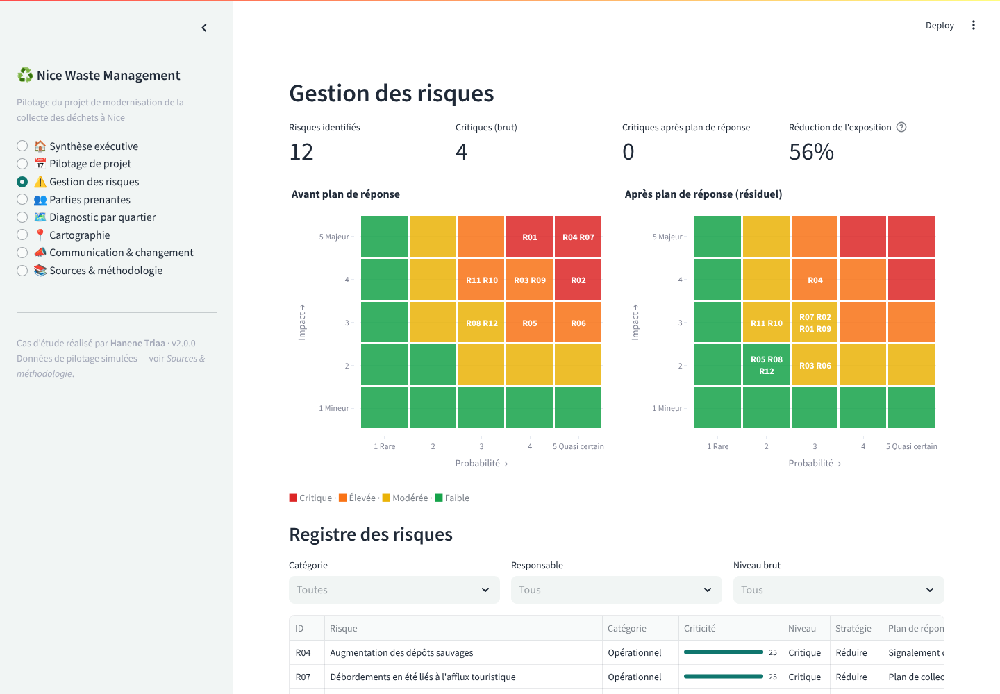
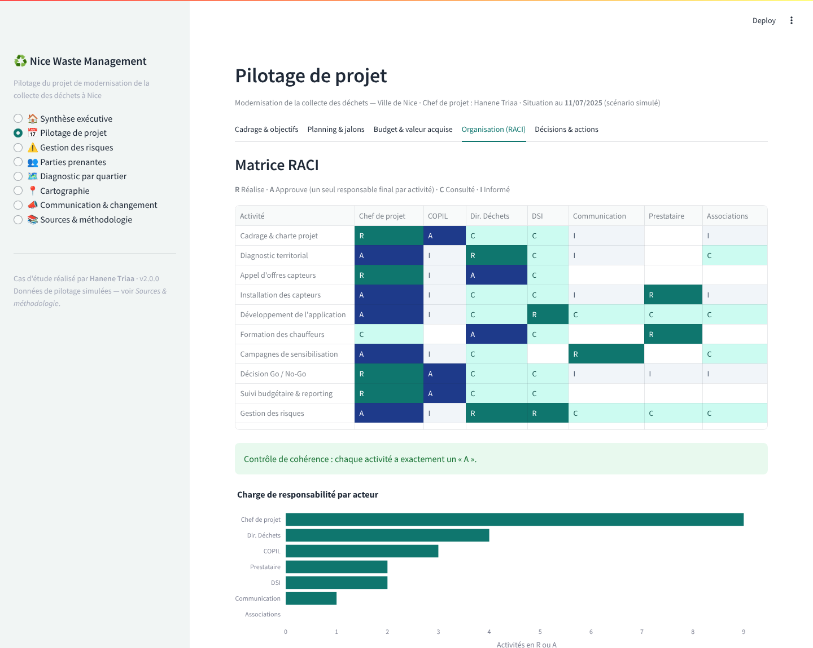
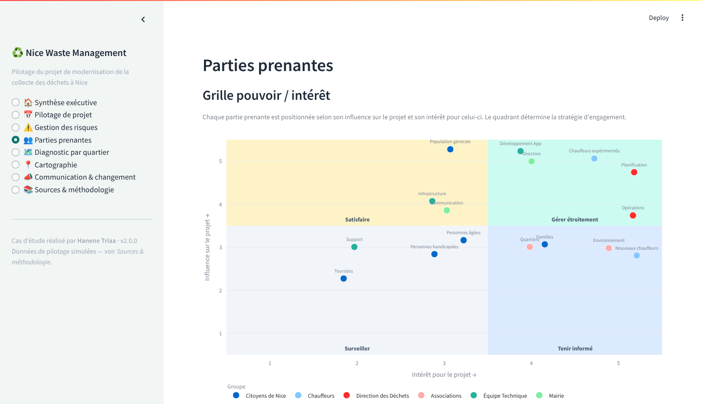
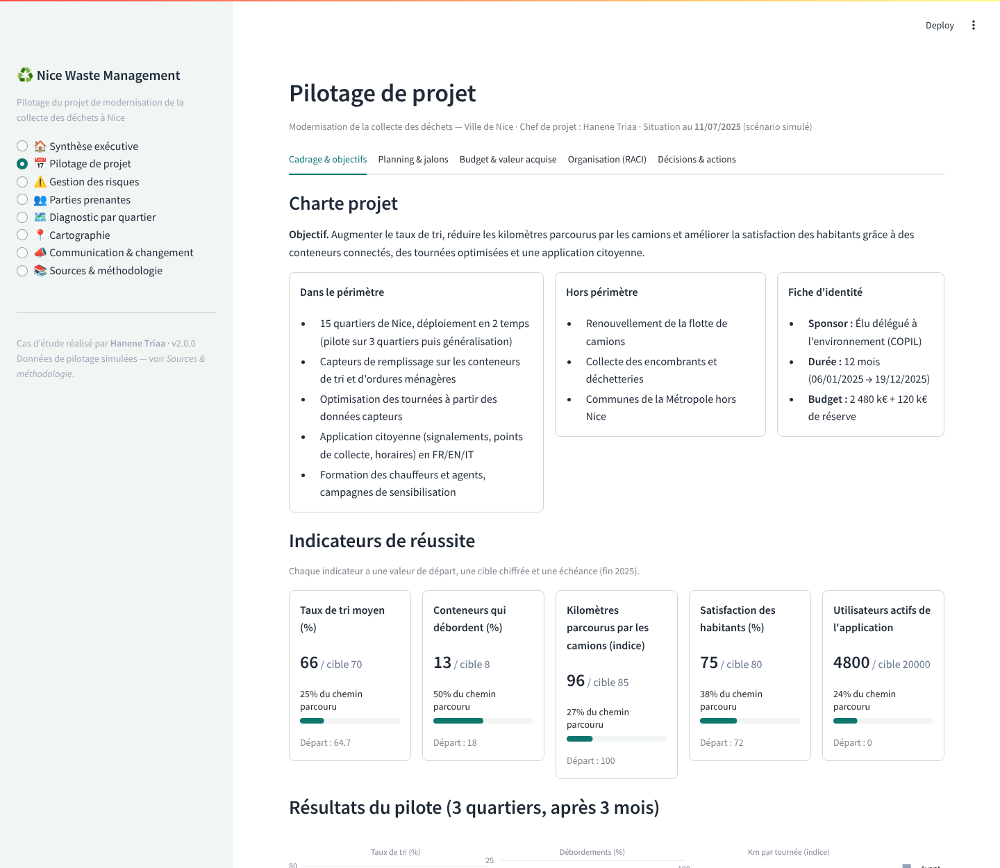

# Nice Waste Management

**Application de pilotage d'un projet de modernisation de la collecte des déchets à Nice**


[](https://nice-waste-management.streamlit.app)

**Démo en ligne : [nice-waste-management.streamlit.app](https://nice-waste-management.streamlit.app)**

Ce projet est un **cas d'étude en gestion de projet**. J'y conduis, de bout en bout, un projet public
fictif mais réaliste : équiper les 15 quartiers de Nice de conteneurs connectés, optimiser les tournées
de collecte et lancer une application citoyenne, en 12 mois et avec un budget de 2,5 M€.

J'ai développé l'application qui sert d'**outil de pilotage** au chef de projet. On y trouve le cadrage,
le planning, le budget, les risques, les parties prenantes, la gouvernance et la conduite du changement.



---

## Le projet en bref

| | |
|---|---|
| **Problème** | Conteneurs qui débordent (18 %), taux de tri moyen de 65 %, tournées planifiées à l'aveugle, quartiers aux contraintes très différentes (centre historique, quartiers sensibles, collines, zones touristiques) |
| **Objectifs (fin 2025)** | Taux de tri : 70 % · conteneurs qui débordent : < 8 % · kilomètres parcourus par les camions : –15 % · satisfaction des habitants : 80 % · 20 000 utilisateurs de l'application |
| **Solution** | Capteurs de remplissage, algorithme d'optimisation des tournées, application citoyenne FR/EN/IT, formation des agents, campagnes de sensibilisation |
| **Approche** | Pilote sur 3 quartiers représentatifs, puis décision Go / No-Go, puis généralisation aux 12 autres quartiers |
| **Cadre** | 12 mois · 19 tâches · 9 jalons · 7 acteurs · budget de 2 480 k€ + 120 k€ de réserve pour aléas |

## Ce que le projet met en pratique

| Compétence | Mise en œuvre dans l'application |
|---|---|
| **Cadrage** | Charte projet : objectif, périmètre inclus et exclu, sponsor, budget, indicateurs SMART |
| **Planification** | Découpage en tâches (WBS), diagramme de Gantt avec dépendances, jalons et critères d'atteinte |
| **Maîtrise des coûts et des délais** | Méthode de la valeur acquise (EVM) : PV, EV, AC, **SPI**, **CPI**, estimation à terminaison, courbe en S |
| **Gestion des risques** | Registre de 12 risques, matrice probabilité × impact, stratégies de réponse, risque résiduel, responsable par risque |
| **Parties prenantes** | Grille pouvoir / intérêt (Mendelow), stratégie d'engagement par quadrant, implication par phase |
| **Organisation et gouvernance** | Matrice RACI avec contrôle automatique (un seul « A » par activité), instances (COPIL, comité projet, comité technique…) |
| **Pilotage et reporting** | Synthèse exécutive avec météo projet, journal des décisions, plan d'actions, retour d'expérience |
| **Conduite du changement** | Plan de communication par cible, plan de formation, communication de crise, suivi des campagnes et des retours usagers |
| **Prise de décision fondée sur les données** | Résultats du pilote avant / après, qui justifient la décision de généralisation |

## Aperçu

<table>
<tr>
<td width="50%"><b>Planning et jalons</b><br>Gantt coloré par statut ou par phase, ligne de la date de reporting, jalons atteints et à venir.<br></td>
<td width="50%"><b>Budget et valeur acquise</b><br>Courbe en S, indices SPI / CPI, estimation à terminaison et analyse du chef de projet.<br></td>
</tr>
<tr>
<td><b>Matrice des risques</b><br>Criticité avant et après le plan de réponse, registre filtrable.<br></td>
<td><b>Matrice RACI et gouvernance</b><br>Rôles par activité, charge de responsabilité, instances de pilotage.<br></td>
</tr>
<tr>
<td><b>Parties prenantes</b><br>Grille pouvoir / intérêt et stratégie d'engagement.<br></td>
<td><b>Cadrage et résultats du pilote</b><br>Charte projet, indicateurs de réussite, résultats avant / après.<br></td>
</tr>
</table>

## L'histoire du projet (situation au 11/07/2025)

1. **Cadrage (janvier à mars).** Diagnostic des 15 quartiers, cartographie des parties prenantes et appel d'offres pour les capteurs. Le marché est attribué avec une semaine de retard, absorbée par la marge du planning.
2. **Pilote (avril à juin).** 3 quartiers représentatifs : Vieux-Nice (touristique), L'Ariane (quartier sensible) et Cimiez (résidentiel). Le taux de tri gagne +3 à +6 points, les débordements sont divisés par 2 et les kilomètres parcourus baissent de 9 à 13 %. Le COPIL décide **GO** pour la généralisation.
3. **Généralisation (en cours).** La pose des capteurs en zone dense prend du retard (SPI 0,95, CPI 0,93). Le chef de projet propose un plan de rattrapage, que le COPIL valide : 2 équipes de pose supplémentaires (+45 k€ pris sur la réserve). Un dossier d'arbitrage budgétaire est en préparation.

La page *Synthèse exécutive* résume cette situation en un écran, pour un élu ou un sponsor.

## Structure du code

```
nice_waste_management/
├── app.py                          # Point d'entrée et navigation
├── src/
│   ├── components/                 # Une page = un module
│   │   ├── dashboard.py            # Synthèse exécutive
│   │   ├── project_management.py   # Cadrage, Gantt, valeur acquise, RACI, décisions
│   │   ├── risks.py                # Matrice de criticité et registre des risques
│   │   ├── stakeholders.py         # Grille pouvoir / intérêt
│   │   ├── communication.py        # Plan de communication, campagnes, retours usagers
│   │   ├── quartiers.py, maps.py   # Diagnostic territorial
│   │   └── sources.py              # Sources et méthodologie
│   ├── data/                       # Données du projet (planning, risques, acteurs, quartiers…)
│   └── utils/
│       ├── project_metrics.py      # Calculs : avancement prévu, statuts, EVM, météo projet
│       └── config.py               # Paramètres et palette de couleurs
├── docs/screenshots/
└── requirements.txt
```

Les indicateurs ne sont pas saisis à la main : ils sont **calculés** à partir des données de planning et
de budget. Par exemple, le statut « En retard » d'une tâche, le SPI, le CPI et la météo projet se mettent
à jour automatiquement quand on modifie l'avancement d'une tâche dans `src/data/project_data.py`.

## Lancer l'application

```bash
git clone https://github.com/hanenetriaa/nice_waste_management.git
cd nice_waste_management
python -m venv .venv && source .venv/bin/activate   # Windows : .venv\Scripts\activate
pip install -r requirements.txt
streamlit run app.py
```

L'application s'ouvre sur http://localhost:8501.

**Mise en ligne gratuite :** sur [Streamlit Community Cloud](https://streamlit.io/cloud), choisir « New app », sélectionner ce dépôt et `app.py`. Un `Procfile` est aussi fourni pour un déploiement de type Heroku ou Render.

## À propos des données

- Les **données territoriales** (population, quartiers) s'appuient sur des sources publiques (INSEE, Métropole Nice Côte d'Azur, ADEME). Les valeurs sont arrondies.
- Les **données de pilotage** (planning, budget, avancement, risques, résultats du pilote) sont **simulées** pour illustrer la démarche. Elles ne reflètent pas l'activité réelle de la Métropole Nice Côte d'Azur.

## Auteure

**Hanene Triaa** · [GitHub](https://github.com/hanenetriaa)

Projet réalisé pour mettre en pratique les méthodes de gestion de projet sur un cas concret de service public.
